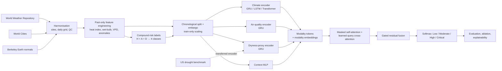
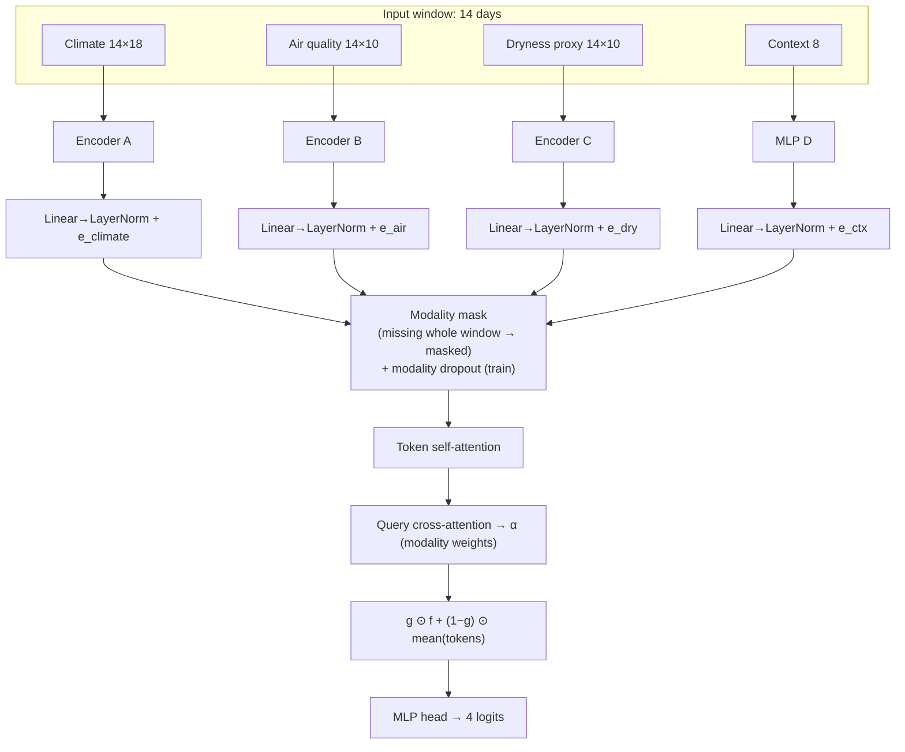
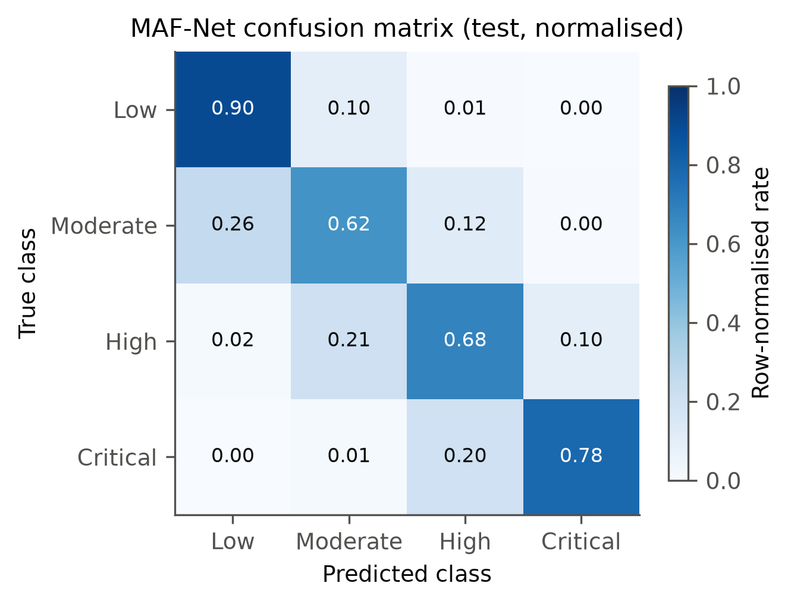
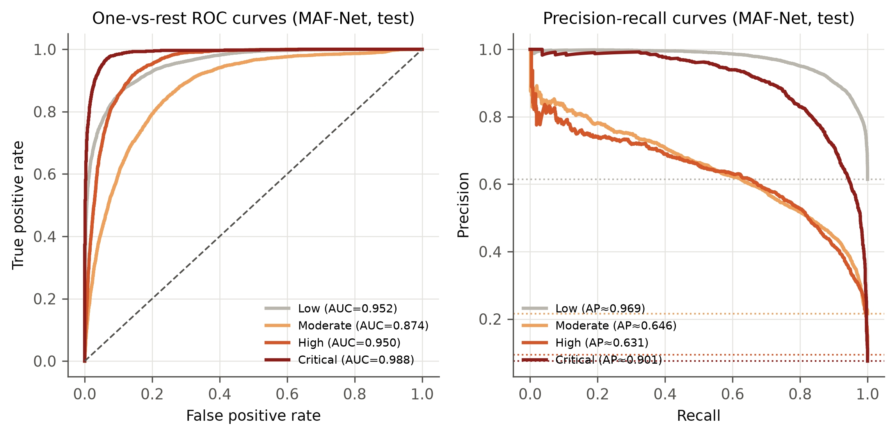
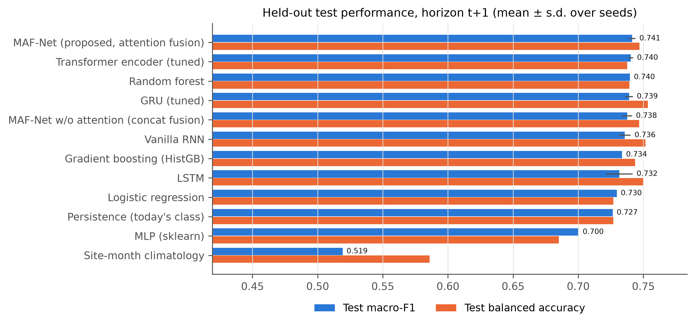
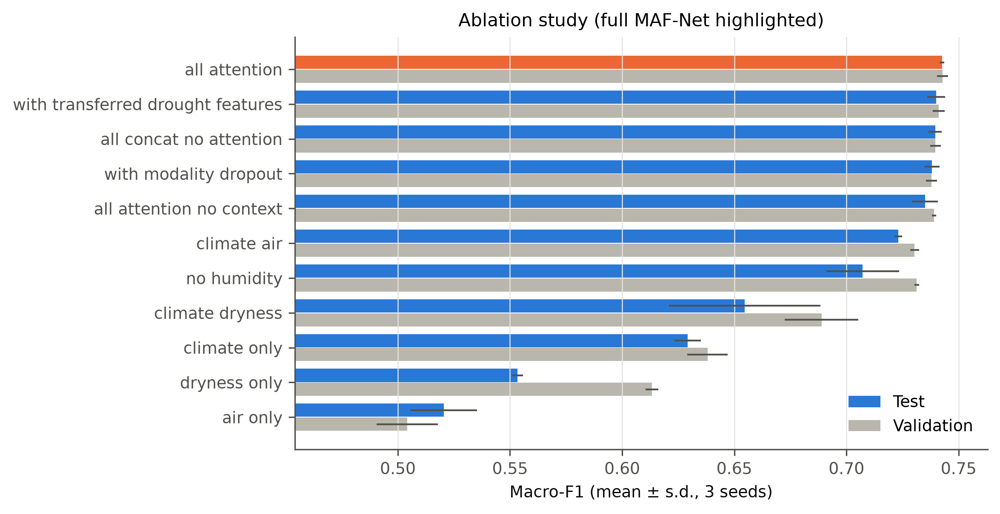
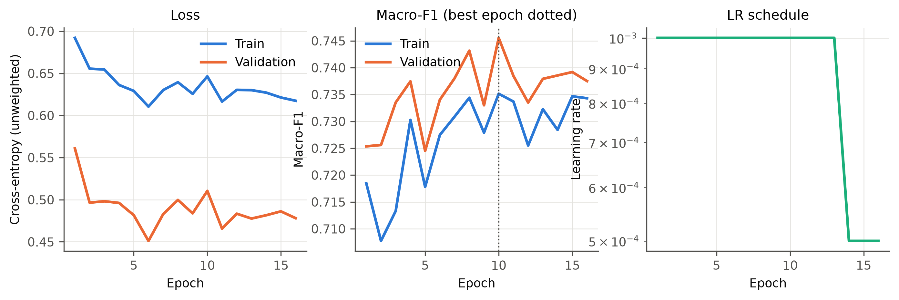
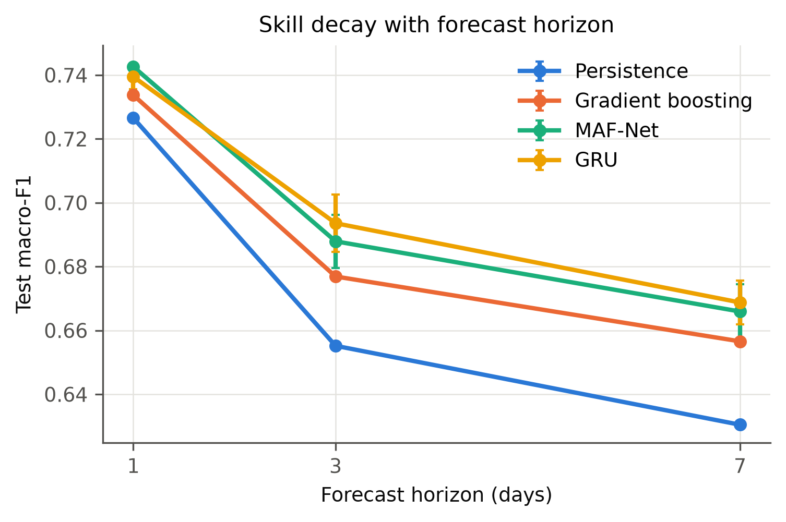

# ClimateSense AI

**A Multimodal Attention-Based Deep Learning Framework for Early Detection of Compound Climate Habitability Risk**

Debshata Choudhury · Enrollment A2305223104 · Course: Generative AI · Amity University (2026)

---

## 1. Motivation

Dangerous environmental conditions rarely come from one variable. Heat is far more dangerous in
humid air, it often coincides with ozone or particulate pollution, and dry spells raise evaporative
stress at the same time. Heat warnings, air-quality indices and drought monitors are usually issued
separately, so days on which several *moderate* stresses co-occur can be missed.

## 2. Problem statement and research question

> Can a multimodal deep learning framework integrating meteorological, air-quality and
> drought-related indicators improve the identification of compound environmental conditions
> associated with reduced human habitability compared with models based on individual
> environmental modalities?

**Task.** From the preceding 14 days of observations at a capital-city site, forecast the
site's compound-risk class on the next day (primary, *h* = 1) and 3 or 7 days ahead (secondary).
Classes: **Low, Moderate, High, Critical** — a *project-defined* index of concurrent environmental
stress (heat-humidity, air quality, dryness), **not** a statement that a place is habitable or
uninhabitable. Exact definition: [`docs/label_definition.md`](docs/label_definition.md).

## 3. Key contributions

* Leakage-safe harmonisation of four public datasets into a daily panel of 185 capital-city sites
  (coordinate-based site identity, haversine joins, past-only features, training-only scalers,
  window-admission rule that embargoes look-back + horizon at split boundaries).
* A transparent four-class compound-risk label from published thresholds (NWS heat index,
  wet-bulb, WHO 2021 air-quality guidelines) plus a VPD-based dryness proxy, with sensitivity analysis.
* **MAF-Net** — branch-wise temporal encoders, masked modality attention (learned query
  cross-attention with key-padding masks for missing modalities), gated residual fusion and
  modality dropout.
* A fair evaluation: naive / classical / tuned RNN-family and Transformer baselines, Optuna
  tuning for proposed *and* baseline models, 3–5 seeds, single held-out future test period,
  site-block bootstrap CIs, paired comparisons, 12 distinct ablation configurations, horizon / look-back / unseen-city
  tests, and a cross-domain transfer experiment from a US drought benchmark.
* Executed notebooks, tests, and an IEEE-format report generated from the stored artefacts.

## 4. Data

| Dataset | Kaggle handle | Role |
|---|---|---|
| World Weather Repository (v1105) | `nelgiriyewithana/global-weather-repository` | daily capital-city weather + air quality — inputs and labels |
| World Cities (v12) | `juanmah/world-cities` | coordinates, ISO codes, population (context) |
| Berkeley Earth (v2) | `berkeleyearth/climate-change-earth-surface-temperature-data` | 1961–1990 monthly normals, long-term warming (context, temperature anomaly) |
| US Drought & Meteorological (v5) | `cdminix/us-drought-meteorological-data` | auxiliary drought benchmark and transfer learning only (US counties are **never** joined to capitals) |

Observed SPEI, soil moisture and NDVI were **not** available within the permitted datasets, so the
drought/soil/vegetation branch is realised as an **observed atmospheric dryness proxy**
(vapour-pressure deficit and precipitation-occurrence history). No synthetic substitutes were
generated. Details and quality issues: [`docs/dataset_documentation.md`](docs/dataset_documentation.md).

## 5. Architecture





Static figure: [`results/figures/architecture_mafnet.png`](results/figures/architecture_mafnet.png).
Shapes and parameter counts: [`docs/model_architecture.md`](docs/model_architecture.md).

## 6. Installation

```bash
python -m venv .venv
.venv/Scripts/python -m pip install torch==2.14.1 --index-url https://download.pytorch.org/whl/cu126
.venv/Scripts/python -m pip install -r requirements-dev.txt
```

(Linux/macOS: `.venv/bin/python`.) The cu126 wheel keeps support for older (Pascal) GPUs; the code
also runs on CPU. Put your Kaggle token in a local `.env` (see `.env.example`); it is git-ignored.

## 7. Usage

```bash
python scripts/download_datasets.py                  # data acquisition (+ provenance manifest)
python scripts/prepare_data.py --force               # harmonisation, features, labels, splits
python scripts/inspect_datasets.py                   # quality audit + EDA figures
python scripts/analyze_labels.py                     # label sensitivity / validity
python scripts/train_baselines.py --horizon 1        # naive + classical baselines
python scripts/train_drought_aux.py                  # US drought benchmark + transfer features
python scripts/run_experiments.py --stage neural_baselines
python scripts/run_experiments.py --stage tune       # Optuna (validation macro-F1)
python scripts/run_experiments.py --stage seeds      # multi-seed retraining of selected configs
python scripts/run_experiments.py --stage ablation
python scripts/run_experiments.py --stage horizons
python scripts/run_experiments.py --stage lookback
python scripts/run_experiments.py --stage spatial
python scripts/evaluate_models.py                    # single held-out test evaluation
python scripts/explain_model.py                      # permutation importance, IG, case studies
python scripts/generate_figures.py
python scripts/build_notebooks.py                    # build + execute the 11 notebooks
python scripts/generate_report.py                    # IEEE DOCX (+ PDF via MS Word)
python -m pytest
```

Every stage is resumable (run-ids are hashes of the full configuration; completed runs are skipped).
**Inference** with the selected checkpoint: see notebook 11 or
`climatesense.training.trainer.load_trained()` + `predict()`.

<!-- RESULTS -->
## 8. Results (held-out test period 2026-06-03 → 2026-10-12, horizon 1 day)

**Selected MAF-Net** (`final-mafnet-4ac9637255`, chosen by validation macro-F1): macro-F1 **0.741** (95 % site-block bootstrap CI 0.714–0.762), accuracy **0.807**, balanced accuracy **0.744**, macro precision 0.742, macro recall 0.744, weighted F1 0.808, macro ROC-AUC **0.941**, macro PR-AUC 0.787.

### Model comparison (mean over seeds; validation used for selection, test reported once)

| Model                                 | Inputs                    |   Seeds | Val macro-F1   |   Test acc. |   Test bal. acc. |   Test macro-F1 |   ± s.d. |   Test W-F1 |   Test ROC-AUC |   Test PR-AUC |
|:--------------------------------------|:--------------------------|--------:|:---------------|------------:|-----------------:|----------------:|---------:|------------:|---------------:|--------------:|
| MAF-Net (proposed, attention fusion)  | C+A+D+ctx                 |       5 | 0.742          |       0.806 |            0.747 |           0.741 |    0.003 |       0.807 |          0.941 |         0.785 |
| Transformer encoder (tuned)           | C+A+D (single stream)+ctx |       3 | 0.744          |       0.81  |            0.738 |           0.74  |    0.002 |       0.808 |          0.946 |         0.793 |
| Random forest                         | C+A+D (aggregated)        |       1 | 0.74           |       0.806 |            0.739 |           0.74  |    0     |       0.808 |          0.945 |         0.789 |
| GRU (tuned)                           | C+A+D (single stream)+ctx |       5 | 0.741          |       0.798 |            0.754 |           0.739 |    0.003 |       0.804 |          0.944 |         0.784 |
| MAF-Net w/o attention (concat fusion) | C+A+D+ctx                 |       5 | 0.741          |       0.801 |            0.747 |           0.738 |    0.004 |       0.804 |          0.939 |         0.778 |
| Vanilla RNN                           | C+A+D (single stream)+ctx |       3 | 0.74           |       0.798 |            0.752 |           0.736 |    0.004 |       0.803 |          0.942 |         0.781 |
| Gradient boosting (HistGB)            | C+A+D (aggregated)        |       1 | 0.74           |       0.802 |            0.744 |           0.734 |    0     |       0.805 |          0.944 |         0.787 |
| LSTM                                  | C+A+D (single stream)+ctx |       3 | 0.739          |       0.793 |            0.75  |           0.732 |    0.01  |       0.799 |          0.942 |         0.778 |
| Logistic regression                   | C+A+D (aggregated)        |       1 | 0.729          |       0.801 |            0.727 |           0.73  |    0     |       0.803 |          0.938 |         0.76  |
| Persistence (today's class)           | label history             |       1 | —              |       0.798 |            0.727 |           0.727 |    0     |       0.798 |          0.822 |         0.595 |
| MLP (sklearn)                         | C+A+D (aggregated)        |       1 | 0.718          |       0.792 |            0.685 |           0.7   |    0     |       0.784 |          0.936 |         0.764 |
| Site-month climatology                | —                         |       1 | —              |       0.614 |            0.586 |           0.519 |    0     |       0.637 |          0.727 |         0.41  |
| Majority class                        | —                         |       1 | —              |       0.614 |            0.25  |           0.19  |    0     |       0.468 |          0.5   |         0.25  |

Paired site-block bootstrap of Δ macro-F1 (selected MAF-Net − other) on identical test samples:

| vs | Δ macro-F1 | 95 % CI |
|---|---|---|
| persistence | +0.015 | [+0.007, +0.022] |
| hist_gradient_boosting | +0.008 | [+0.001, +0.015] |
| random_forest | +0.002 | [-0.005, +0.009] |
| gru | +0.003 | [-0.004, +0.009] |
| mafnet_concat | +0.005 | [-0.001, +0.011] |
| transformer | +0.001 | [-0.005, +0.007] |

### Per-class test metrics (selected MAF-Net)

| class    |   precision |   recall |    f1 |   support |   roc_auc |   pr_auc |
|:---------|------------:|---------:|------:|----------:|----------:|---------:|
| Low      |       0.906 |    0.897 | 0.901 |     13020 |     0.952 |    0.969 |
| Moderate |       0.624 |    0.618 | 0.621 |      4576 |     0.874 |    0.646 |
| High     |       0.588 |    0.677 | 0.629 |      2003 |     0.95  |    0.631 |
| Critical |       0.848 |    0.783 | 0.815 |      1593 |     0.988 |    0.901 |

### Ablation (3 seeds each)

| Variant                           | Inputs              |   Val macro-F1 |   Test macro-F1 |   ± s.d. |   Test bal. acc. |   Test ROC-AUC |
|:----------------------------------|:--------------------|---------------:|----------------:|---------:|-----------------:|---------------:|
| all_attention                     | C+A+D+ctx           |          0.743 |           0.743 |    0.001 |            0.748 |          0.941 |
| with_transferred_drought_features | C+A+D+ctx+TL        |          0.741 |           0.74  |    0.004 |            0.743 |          0.94  |
| all_concat_no_attention           | C+A+D+ctx           |          0.74  |           0.74  |    0.003 |            0.748 |          0.939 |
| with_modality_dropout             | C+A+D+ctx           |          0.738 |           0.738 |    0.003 |            0.743 |          0.94  |
| all_attention_no_context          | C+A+D               |          0.739 |           0.735 |    0.006 |            0.746 |          0.939 |
| climate_air                       | C+A+ctx             |          0.73  |           0.723 |    0.002 |            0.728 |          0.931 |
| no_humidity                       | C+A+D+ctx −humidity |          0.731 |           0.707 |    0.016 |            0.725 |          0.928 |
| climate_dryness                   | C+D+ctx             |          0.689 |           0.655 |    0.034 |            0.679 |          0.905 |
| climate_only                      | C                   |          0.638 |           0.629 |    0.006 |            0.635 |          0.876 |
| dryness_only                      | D                   |          0.613 |           0.553 |    0.002 |            0.59  |          0.825 |
| air_only                          | A                   |          0.504 |           0.52  |    0.015 |            0.544 |          0.825 |

### Figures

| | |
|---|---|
|  |  |
|  |  |
|  |  |

More: `results/figures/` (EDA, labels, explainability, calibration, Optuna). Tables: `results/tables/`.

## 9. Interpretation

* **H1 (multimodal > unimodal): supported.** Full MAF-Net 0.743 vs climate-only 0.629, dryness-only 0.553, air-only 0.520 (test macro-F1, 3 seeds).
* **H2 (attention > concatenation): not supported.** 0.741 vs 0.738 (5 seeds); paired Δ for the selected checkpoint +0.005, 95 % CI [-0.001, +0.011].
* **H3 (learned > persistence): supported on the sampled cities, small effect.** Δ macro-F1 = +0.015 (CI [+0.007, +0.022]); the gap widens with horizon (+0.035 at 7 days). **On unseen cities** MAF-Net (0.706) and GRU (0.709) did **not** beat persistence (0.713).
* MAF-Net has the highest mean test macro-F1 of all models, but its margins over the tuned Transformer, random forest and GRU are within seed variability (paired CIs include 0).
* **Where the skill comes from:** 79 % of test days keep yesterday's class. On transition days MAF-Net is right 29 % of the time (persistence 0 %), and it anticipates 35 % of High/Critical onsets.
* **Observation-hour bias:** macro-F1 ranges 0.43–0.76 across longitude bands, tracking how often High/Critical occurs at the locally sampled hour (`results/figures/validity/`).
* Labels are project-defined rule outputs; none of these results are health outcomes or habitability determinations.
<!-- /RESULTS -->

## 10. Notebooks

| # | Notebook | Content |
|---|---|---|
| 01 | [Dataset acquisition](notebooks/01_dataset_acquisition.ipynb) | provenance, schemas, sizes |
| 02 | [EDA](notebooks/02_exploratory_data_analysis.ipynb) | distributions, missingness, maps, observation-hour bias |
| 03 | [Cleaning & integration](notebooks/03_data_cleaning_and_integration.ipynb) | site definition, joins, splits |
| 04 | [Features & labels](notebooks/04_feature_engineering_and_labels.ipynb) | formulas, label rules, sensitivity |
| 05 | [Baselines](notebooks/05_baseline_models.ipynb) | naive and classical models |
| 06 | [RNN / LSTM / GRU / Transformer](notebooks/06_lstm_gru_experiments.ipynb) | sequence baselines |
| 07 | [MAF-Net](notebooks/07_attention_fusion_model.ipynb) | architecture, tensor shapes |
| 08 | [Hyper-parameter optimisation](notebooks/08_hyperparameter_optimization.ipynb) | Optuna trials |
| 09 | [Evaluation](notebooks/09_model_evaluation.ipynb) | test metrics, CM, ROC/PR, CIs |
| 10 | [Ablation & explainability](notebooks/10_ablation_and_explainability.ipynb) | ablations, importance, case studies |
| 11 | [Final results & inference](notebooks/11_final_results_and_inference.ipynb) | reproducible inference |

## 11. Repository structure

```text
configs/        data, preprocessing, training, model and experiment settings
data/           raw/ processed/ (git-ignored) and manifests/ (provenance + audits, committed)
docs/           methodology, datasets, labels, architecture, experiment log, limitations, status
experiments/    per-run JSON records (config, history, validation metrics), Optuna DB, summaries
models/best/    selected MAF-Net checkpoint + config
notebooks/      11 executed notebooks
reports/final/  IEEE-format report (DOCX, PDF)
results/        metrics/ tables/ figures/ analysis/
scripts/        pipeline entry points
src/climatesense/  data, features, labeling, models, training, evaluation, explainability, utils
tests/          pytest suite (pipeline, alignment, leakage, labels, models, metrics)
```

## 12. Reproducibility

Seeds, deterministic cuDNN, resumable run registry, data versions and remaining sources of
nondeterminism are documented in [`docs/reproducibility.md`](docs/reproducibility.md).

## 13. Limitations

Short (≈ 2.4-year) record and a single four-month test period; capital-city sampling; one daily
snapshot whose local hour depends on longitude (biasing heat stress by region); provider
air-quality regime shifts; no observed SPEI / soil moisture / NDVI; project-defined labels that are
deterministic functions of observed variables and are not externally validated. Full list:
[`docs/limitations.md`](docs/limitations.md).

## 14. Future work

Integrate NASA POWER soil wetness, SPEIbase and MODIS NDVI/EVI through the existing dryness
branch; use hourly or daily-maximum observations; validate classes against EM-DAT and health
records; multi-year rolling-origin and climate-zone-stratified evaluation.

## 15. References

1. IPCC, *Climate Change 2021: The Physical Science Basis*, SPM, 2021, doi:10.1017/9781009157896.001.
2. J. Zscheischler et al., "Future climate risk from compound events," *Nat. Clim. Change* 8, 469–477, 2018, doi:10.1038/s41558-018-0156-3.
3. C. Raymond, T. Matthews, R. M. Horton, *Science Advances* 6(19), eaaw1838, 2020, doi:10.1126/sciadv.aaw1838.
4. WHO, *WHO Global Air Quality Guidelines*, 2021.
5. S. M. Vicente-Serrano et al., "SPEI," *J. Climate* 23(7), 1696–1718, 2010, doi:10.1175/2009JCLI2909.1.
6. T. Baltrušaitis, C. Ahuja, L.-P. Morency, "Multimodal machine learning: A survey and taxonomy," *IEEE TPAMI* 41(2), 423–443, 2019, doi:10.1109/TPAMI.2018.2798607.
7. A. Vaswani et al., "Attention is all you need," *NeurIPS* 30, 2017.
8. R. Stull, "Wet-bulb temperature from relative humidity and air temperature," *JAMC* 50(11), 2267–2269, 2011, doi:10.1175/JAMC-D-11-0143.1.
9. L. P. Rothfusz, "The heat index equation," NWS Tech. Attachment SR 90-23, 1990.
10. Kaggle datasets listed in §4 (see the IEEE report for full citations).

## 16. Author

**Debshata Choudhury** — Section 7CSE-2X, Amity University, Noida (Enrollment A2305223104).
Course: Generative AI (Prof. M. K. Dutta, Amity Centre for Artificial Intelligence).
Licence: MIT (code). Data remain under their original licences.
